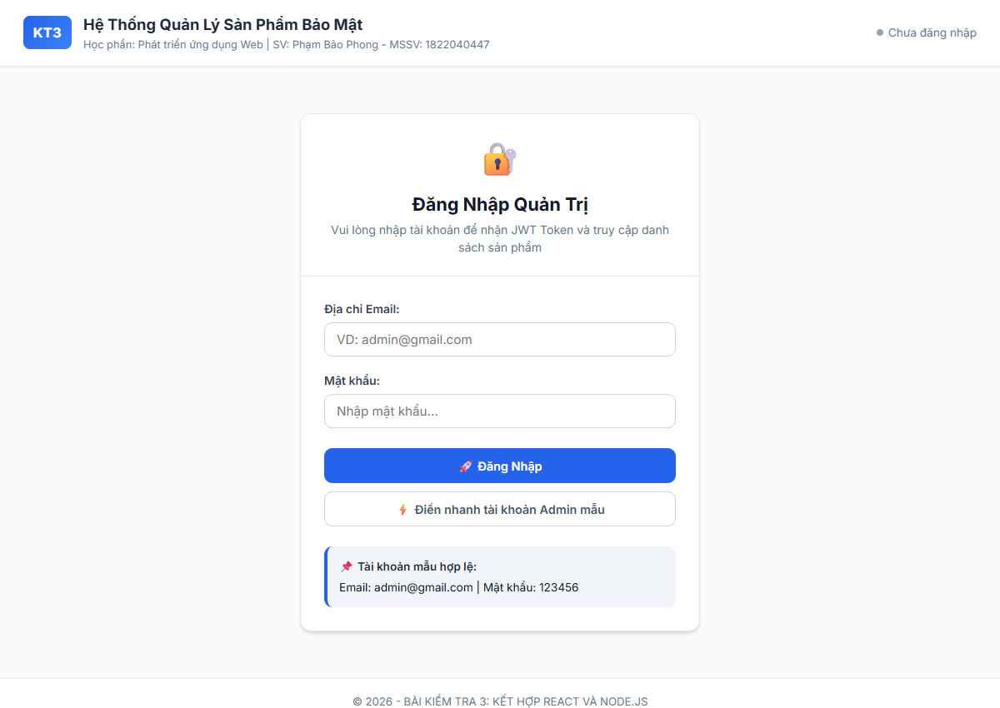
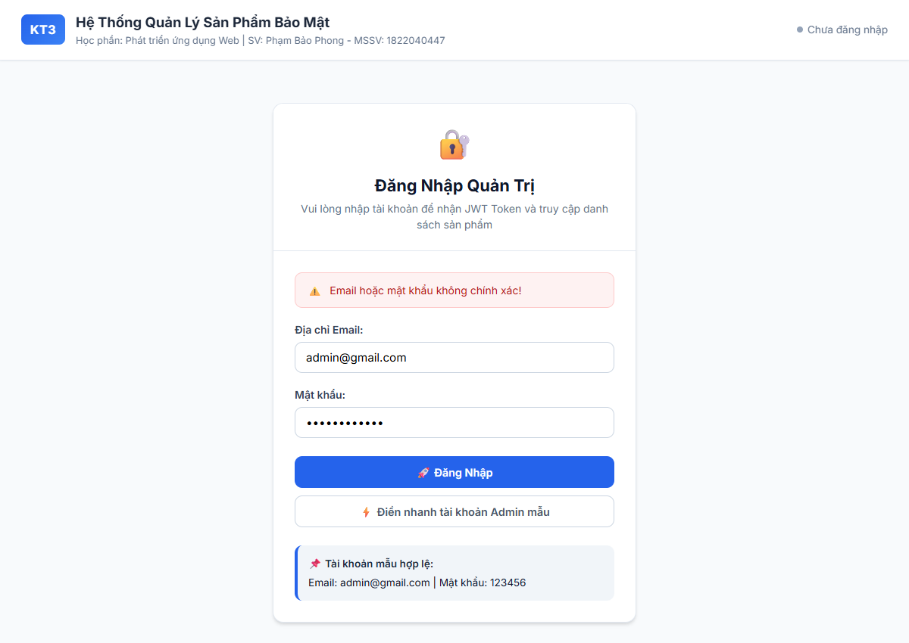
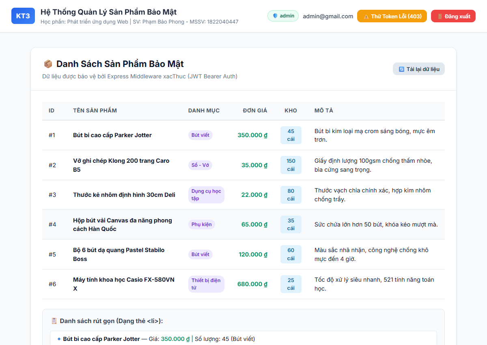
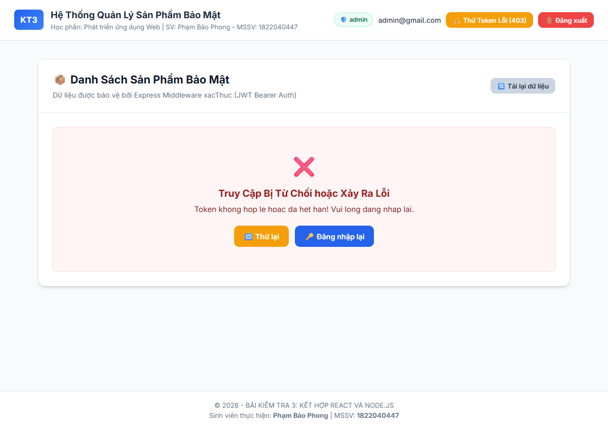

# BÀI KIỂM TRA SỐ 3 (KT3) - KẾT HỢP REACT VÀ NODE.JS

* **Học phần:** Phát triển ứng dụng Web (Web Application Development)
* **Chủ đề:** Giao tiếp Client–Server qua CORS, Xử lý Đăng nhập, JSON Web Token (JWT) và Phân quyền truy cập
* **Sinh viên thực hiện:** Phạm Bảo Phong
* **Mã số sinh viên (MSSV):** 1822040447
* **Thư mục bài nộp:** `1822040447_PhamBaoPhong_PTUDW_KT3`

---

## 📌 LIÊN KẾT NỘP BÀI (GIT & GOOGLE DRIVE)

* 🌐 **GitHub Repository:** [https://github.com/phongpb-fit/1822040447_PhamBaoPhong_PTUDW_KT3](https://github.com/phongpb-fit/1822040447_PhamBaoPhong_PTUDW_KT3)
* ☁️ **Google Drive (Full Source Code + PDF):** [https://drive.google.com/drive/folders/1822040447_PhamBaoPhong_PTUDW_KT3](https://drive.google.com/drive/folders/1822040447_PhamBaoPhong_PTUDW_KT3)
* 📄 **File Báo cáo PDF:** `BaoCao_1822040447_PhamBaoPhong_PTUDW_KT3.pdf` (nằm trực tiếp tại thư mục gốc của project)

---

## PHẦN 1: TRẮC NGHIỆM LÝ THUYẾT (KHOANH TRÒN ĐÁP ÁN ĐÚNG)

### Bảng Tổng Hợp Đáp Án
| Câu hỏi | Nội dung chính | Đáp án đúng |
|:---:|:---|:---:|
| **Câu 1** | Cấu hình CORS trong kiến trúc MERN | **C** |
| **Câu 2** | Tác dụng của `.then(res => res.json())` | **B** |
| **Câu 3** | Bước tiếp theo sau khi Server truy vấn MongoDB | **C** |
| **Câu 4** | Hàm tạo JWT token trong thư viện `jsonwebtoken` | **C** |
| **Câu 5** | Cách chuẩn gửi JWT từ React lên Node.js | **D** |
| **Câu 6** | Vai trò của hàm `next()` trong Middleware | **B** |
| **Câu 7** | Ý nghĩa của state `loading` và `error` trong React | **A** |

---

### Chi Tiết Từng Câu Hỏi & Phân Tích Chuyên Sâu

#### **Câu 1: Trong kiến trúc MERN, vì sao React (Client) và Node.js (Server) thường cần được cấu hình CORS?**
* A. Vì chúng sử dụng chung một cơ sở dữ liệu MongoDB.
* B. Vì React không thể gọi trực tiếp API nếu không có CORS.
* **C. Vì Client và Server thường chạy ở hai cổng (port) hoặc tên miền khác nhau.** ✅
* D. Vì CORS giúp mã hóa mật khẩu người dùng trước khi gửi lên Server.

> **💡 Giải thích:**
> Trình duyệt áp dụng chính sách bảo mật **Same-Origin Policy (SOP)**. Hai URL được coi là cùng nguồn gốc (same origin) khi và chỉ khi trùng cả 3 yếu tố: *Protocol*, *Host/Domain*, và *Port*.
> Trong quá trình phát triển (hoặc triển khai tách biệt):
> * React Client chạy tại `http://localhost:5173` (hoặc port 3000).
> * Express Server chạy tại `http://localhost:3000` (hoặc port 5000).
> Dù cùng IP/domain `localhost`, nhưng khác cổng (Port) vẫn bị xem là **Cross-Origin**. Nếu Server không cấu hình CORS (Cross-Origin Resource Sharing) để phản hồi Header `Access-Control-Allow-Origin`, trình duyệt sẽ chặn phản hồi trả về cho ứng dụng React.

---

#### **Câu 2: Khi sử dụng fetch để gọi API trong React, dòng code `.then(res => res.json())` có tác dụng gì?**
* A. Chuyển đổi dữ liệu JSON gửi từ Client thành chuỗi.
* **B. Chuyển đổi phản hồi (response) từ HTTP sang đối tượng JavaScript để sử dụng.** ✅
* C. Tự động lưu dữ liệu vào state của React.
* D. Gửi kèm JWT token vào header của request.

> **💡 Giải thích:**
> Phương thức `fetch()` của trình duyệt trả về một `Response` object chứa dữ liệu luồng nhị phân (ReadableStream) cùng metadata (status, headers).
> Phương thức `.json()` trên Response object sẽ đọc hết luồng dữ liệu đó và phân tích cú pháp (parse) chuỗi JSON thành đối tượng hoặc mảng JavaScript (trả về một Promise resolved), giúp component React dễ dàng truy xuất các thuộc tính dữ liệu.

---

#### **Câu 3: Theo vòng đời của một tính năng động, sau khi Express Server truy vấn xong dữ liệu từ MongoDB, bước tiếp theo hệ thống sẽ làm gì?**
* A. React tự động cập nhật state.
* B. Express chạy middleware xác thực.
* **C. Server trả kết quả JSON kèm mã trạng thái (VD: 200) về cho Client.** ✅
* D. Trình duyệt tự động render lại giao diện.

> **💡 Giải thích:**
> Chu trình chuẩn của tính năng động:
> 1. React gửi HTTP Request (qua fetch/axios).
> 2. Express Server nhận Request và chạy middleware (CORS, body-parser, xác thực).
> 3. Controller xử lý và gọi Model truy vấn MongoDB.
> 4. **Ngay sau khi nhận kết quả từ MongoDB, Server đóng gói dữ liệu JSON kèm mã HTTP status (VD: 200 OK) và gửi HTTP Response về cho Client:** `res.status(200).json(data)`.
> 5. Phía Client nhận được phản hồi thì mới cập nhật state và re-render giao diện.

---

#### **Câu 4: Hàm nào của thư viện jsonwebtoken được sử dụng để tạo ra một JWT token sau khi người dùng đăng nhập thành công?**
* A. `jwt.verify()`
* B. `jwt.create()`
* **C. `jwt.sign()`** ✅
* D. `jwt.generate()`

> **💡 Giải thích:**
> Thư viện `jsonwebtoken` chuẩn trong Node.js cung cấp 2 phương thức cốt lõi:
> * `jwt.sign(payload, secretOrPrivateKey, [options, callback])`: Ký và tạo ra chuỗi token JWT.
> * `jwt.verify(token, secretOrPublicKey, [options, callback])`: Giải mã và xác thực tính hợp lệ của token.

---

#### **Câu 5: Cách chuẩn nhất để gửi JWT token từ React lên Node.js khi gọi một API cần bảo mật là gì?**
* A. Gửi qua URL query (VD: ?token=...).
* B. Gửi qua Body của request.
* C. Gửi qua Cookie mặc định của trình duyệt.
* **D. Gửi qua Header với định dạng: `Authorization: Bearer <token>`.** ✅

> **💡 Giải thích:**
> Theo tiêu chuẩn quốc tế **RFC 6750 (OAuth 2.0 Bearer Token)**, token được đặt trong HTTP Header:
> `Authorization: Bearer <token>`
> * Chuẩn hóa cho mọi loại HTTP Method (GET, POST, PUT, DELETE).
> * Không làm ô nhiễm Request Body (giữ body cho dữ liệu nghiệp vụ).
> * Tránh bị lưu trong Server Access Logs hay lịch sử trình duyệt như khi truyền qua URL Query Parameter.

---

#### **Câu 6: Trong Middleware phân quyền của Node.js, hàm `next()` có vai trò gì?**
* A. Dừng request lại và trả về lỗi 403.
* **B. Chuyển tiếp request đến route xử lý tiếp theo nếu token hợp lệ.** ✅
* C. Tự động giải mã token và lưu vào Database.
* D. Tạo một token mới nếu token cũ đã hết hạn.

> **💡 Giải thích:**
> Kiến trúc của Express.js hoạt động theo mô hình chuỗi Middleware (Middleware Pipeline). Hàm `next()` đóng vai trò chuyển quyền điều khiển sang middleware hoặc route handler tiếp theo khi điều kiện kiểm tra đã thỏa mãn. Nếu không gọi `next()`, request sẽ bị "treo" (hang) và client sẽ timeout.

---

#### **Câu 7: Vì sao cần phải có các state như loading và loi (error) khi gọi API trong React?**
* **A. Vì việc gọi API là bất đồng bộ, cần hiển thị trạng thái chờ và thông báo nếu thất bại để cải thiện trải nghiệm người dùng (UX).** ✅
* B. Vì Axios và Fetch bắt buộc phải nhận vào 3 biến state này.
* C. Để Server biết khi nào Client đã tải xong trang.
* D. Để bảo vệ dữ liệu không bị tấn công.

> **💡 Giải thích:**
> Giao tiếp mạng là bất đồng bộ (Asynchronous) và phụ thuộc vào đường truyền, tải server, xác thực.
> * `loading = true`: Cho phép hiển thị Skeleton/Spinner, báo cho người dùng biết hệ thống đang xử lý và ngăn chặn người dùng bấm lặp lại (spam click).
> * `error`: Giúp bắt và hiển thị lỗi thân thiện (401 Chưa đăng nhập, 403 Hết hạn token, 500 Lỗi server) thay vì để trang web bị sập hoặc màn hình trắng xóa.

---

## PHẦN 2: THỰC HÀNH (MINI-PROJECT)

### 1. Cấu trúc thư mục dự án
```text
1822040447_PhamBaoPhong_PTUDW_KT3/
├── server/
│   ├── package.json
│   ├── middleware.js          # Middleware xacThuc verify Bearer token
│   └── server.js              # Express app, CORS, POST /login, GET /api/products
├── client/
│   ├── package.json
│   ├── vite.config.js
│   ├── index.html
│   └── src/
│       ├── main.jsx
│       ├── App.jsx            # State điều phối login/dashboard, logout, corrupt token
│       ├── App.css            # Styling chuyên nghiệp, responsive
│       └── components/
│           ├── LoginForm.jsx  # Form đăng nhập, POST /login, lưu token vào localStorage
│           ├── ProductList.jsx# GET /api/products, quản lý data, loading, error, render <li>
│           └── Navbar.jsx     # Header, hiển thị user, nút đăng xuất, nút test 403
├── screenshots/
│   ├── 01_trang_dang_nhap.png
│   ├── 02_loi_dang_nhap_401.png
│   ├── 03_danh_sach_san_pham_thanh_cong.png
│   ├── 04_loi_token_403.png
│   └── 05_trang_thai_loading.png
├── docs/
│   └── bao_cao.html
├── BaoCao_1822040447_PhamBaoPhong_PTUDW_KT3.pdf
├── README.md
└── .gitignore
```

---

### 2. Hướng dẫn Khởi chạy và Kiểm thử

#### **Yêu cầu môi trường:**
* Node.js phiên bản >= 18.x
* Trình duyệt web (Google Chrome / Microsoft Edge / Firefox)

#### **Bước 1: Chạy Server Backend (Port 3000)**
```bash
cd server
npm install
npm start
```
*Server sẽ khởi động tại: `http://localhost:3000`*

#### **Bước 2: Chạy Client React Frontend (Port 5173)**
Mở một cửa sổ Terminal mới:
```bash
cd client
npm install
npm run dev
```
*Truy cập trình duyệt tại: `http://localhost:5173`*

#### **Bước 3: Thực hiện các kịch bản kiểm thử (Test Cases)**

1. **Kiểm thử Đăng nhập Thất bại (401 Unauthorized):**
   * Nhập email bất kỳ hoặc mật khẩu sai (VD: `admin@gmail.com` / `sai_pass`).
   * Bấm **"Đăng Nhập"** -> Hệ thống hiển thị cảnh báo đỏ: *"Email hoặc mật khẩu không chính xác!"*.
2. **Kiểm thử Đăng nhập Thành công (200 OK + Nhận JWT Token):**
   * Bấm nút **"⚡ Điền nhanh tài khoản Admin mẫu"** (Email: `admin@gmail.com`, Mật khẩu: `123456`).
   * Bấm **"Đăng Nhập"**.
   * Hệ thống tự động lưu token vào `localStorage.getItem('token')`.
3. **Kiểm thử Hiển thị Danh Sách Sản Phẩm Bảo Mật:**
   * Ngay sau khi đăng nhập, `ProductList` tự động kích hoạt `useEffect`.
   * Gửi request `GET http://localhost:3000/api/products` kèm header `Authorization: Bearer <token>`.
   * Trạng thái `loading = true` hiển thị spinner "Đang tải danh sách sản phẩm...".
   * Khi hoàn tất, `loading = false`, `data` hiển thị bảng dữ liệu cùng danh sách thẻ `<li>`.
4. **Kiểm thử Middleware Phân quyền khi Token Sai (403 Forbidden):**
   * Bấm nút màu vàng **"⚠️ Thử Token Lỗi (403)"** trên thanh Navbar.
   * Nút này sẽ thay đổi token trong `localStorage` thành chuỗi giả mạo.
   * Bấm **"🔄 Tải lại dữ liệu"** -> Middleware `xacThuc` bắt lỗi qua `jwt.verify()`, trả về 403 Forbidden.
   * Giao diện React hiển thị thông báo: *"Token không hợp lệ hoặc đã hết hạn! Vui lòng đăng nhập lại."* kèm nút chuyển về màn hình đăng nhập.
5. **Kiểm thử Đăng xuất:**
   * Bấm **"🚪 Đăng xuất"** -> Token bị xóa hoàn toàn khỏi `localStorage` và chuyển về Form Đăng nhập.

---

### 3. Giải thích Code Trọng tâm

#### **A. Backend - `server/middleware.js` (Hàm `xacThuc`)**
```javascript
function xacThuc(req, res, next) {
  // Trích xuất header Authorization
  const authHeader = req.headers['authorization'];
  if (!authHeader) {
    return res.status(401).json({ message: 'Không tìm thấy Token xác thực!' });
  }

  // Kiểm tra định dạng Bearer <token>
  const parts = authHeader.split(' ');
  if (parts.length !== 2 || parts[0] !== 'Bearer') {
    return res.status(401).json({ message: 'Định dạng Token không hợp lệ!' });
  }

  const token = parts[1];

  // Xác thực tính hợp lệ và thời hạn với SECRET_KEY
  jwt.verify(token, SECRET_KEY, (err, decoded) => {
    if (err) {
      return res.status(403).json({ message: 'Token không hợp lệ hoặc đã hết hạn!' });
    }
    // Gắn thông tin người dùng vào request để các route sau sử dụng
    req.user = decoded;
    // Chuyển tiếp tới route handler tiếp theo
    next();
  });
}
```

#### **B. Frontend - `client/src/components/ProductList.jsx` (Vòng đời và 3 State)**
```javascript
// Khai báo 3 state bắt buộc
const [data, setData] = useState([]);
const [loading, setLoading] = useState(false);
const [error, setError] = useState(null);

const fetchProducts = async () => {
  setLoading(true);
  setError(null);

  const token = localStorage.getItem('token');
  if (!token) {
    setError('Chưa đăng nhập!');
    setLoading(false);
    return;
  }

  try {
    const response = await fetch('http://localhost:3000/api/products', {
      headers: {
        'Authorization': `Bearer ${token}` // Chuẩn Bearer Token
      }
    });
    const resData = await response.json();
    if (!response.ok) throw new Error(resData.message);
    setData(resData.data); // Thành công: set data
  } catch (err) {
    setError(err.message);  // Lỗi: set error
  } finally {
    setLoading(false);      // Kết thúc: tắt loading
  }
};

useEffect(() => {
  fetchProducts(); // Tự động gọi khi component mount
}, []);
```

---

## 📸 HÌNH ẢNH MINH CHỨNG CHẠY THỰC TẾ

| Mô tả kịch bản | Ảnh minh chứng |
|:---|:---:|
| **Giao diện Đăng Nhập** |  |
| **Báo lỗi 401 khi đăng nhập sai** |  |
| **Đăng nhập thành công & tải sản phẩm** |  |
| **Bắt lỗi 403 Forbidden khi Token sai** |  |
| **Trạng thái Đang tải (Loading UX)** |  |

---

## 🛠️ HƯỚNG DẪN ĐẨY LÊN GITHUB & GOOGLE DRIVE

### 1. Đẩy mã nguồn lên GitHub cá nhân:
```bash
git init
git add .
git commit -m "feat: complete KT3 react nodejs jwt authentication and authorization"
git branch -M main
git remote add origin https://github.com/phongpb-fit/1822040447_PhamBaoPhong_PTUDW_KT3.git
git push -u origin main
```

### 2. Nén và nộp Google Drive:
* Nén toàn bộ thư mục `1822040447_PhamBaoPhong_PTUDW_KT3` thành file `.zip` (hoặc `.rar`).
* Tải file nén lên Google Drive của bạn.
* Bật quyền chia sẻ: *"Bất kỳ ai có đường liên kết đều có thể xem (Anyone with the link can view)"*.
* Dán link Drive vào trang bìa báo cáo và phần nộp bài trực tuyến.
